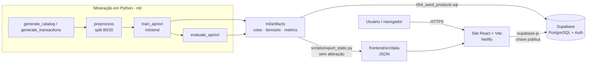

# Arquitetura

## Visão geral

## Camadas

| Camada | Pasta | Responsabilidade |
|---|---|---|
| Mineração | `ml/` | Dataset simulado, pré-processamento, treino e avaliação do Apriori (mlxtend), motor de referência em Python. |
| Exportação | `scripts/export_static.py` | Publica regras, itemsets, métricas e catálogo para o site, e gera a carga SQL do catálogo. |
| Site | `frontend/` | SPA React + TypeScript: catálogo, Carrinho Inteligente, checkout, Laboratório IA, login. Three.js na Home. |
| IPAJ CORE (navegador) | `frontend/src/core/apriori.ts` | Consulta às regras Apriori. Tradução fiel de `ml/recommendation_engine.py`. |
| Dados | `frontend/src/services/api.ts` | Dados estáticos + Supabase (Auth, `create_order`, leitura dos pedidos). |
| Banco | `database/` | `schema.sql` e migrações 002–004 (RLS, privilégios, função de pedido, catálogo). |
| API de referência | `backend/` | FastAPI equivalente, só para uso local e testes. Não é publicada. |

## Fluxo de uma recomendação

1. O usuário altera o carrinho (estado no `CartContext`, persistido no `localStorage`).
2. `useCartRecommendations` aguarda 250 ms (debounce) e chama `api.recommend`.
3. `recommend()` percorre as 394 regras cujo antecedente está **contido** no carrinho e cujo consequente
   **não** está. Para cada candidato fica a regra de maior confiança (desempate por lift).
4. O resultado é ordenado por confiança → lift → ID e limitado a `limit`.
5. Cada item recebe os dados do produto e um texto explicativo (“72% de quem levou…”).
6. Sem regra aplicável, a lista volta vazia com uma mensagem. **Não há fallback** por popularidade, para que toda
   recomendação exibida seja de fato uma regra Apriori.

**Equivalência com o Python:** `export_static.py` grava as saídas do motor Python para todos os 50 produtos e
para os 105 pares frequentes. O teste `frontend/src/test/apriori.test.ts` exige resultado idêntico em todos esses
casos, e `backend/tests/test_export_static.py` exige que `rules.json` seja exatamente o `rules.joblib`.

## Papel do Supabase

- `products`: catálogo com leitura pública. Os preços dos pedidos saem **sempre** daqui.
- `orders` / `order_items`: pedidos demonstrativos. `auth_user_id` liga o pedido à conta do Supabase Auth. Quando é nulo, o pedido é de visitante.
  `from_recommendation` registra os itens que vieram do IPAJ CORE.
- `public.create_order(items, guest_label)`: a **única** forma de gravar. É `SECURITY DEFINER` com `search_path` vazio,
  valida quantidades e produtos, ignora qualquer preço enviado pelo cliente e usa `auth.uid()` como dono.
- RLS: o usuário logado lê só os próprios pedidos. Nenhuma role pública tem INSERT, UPDATE ou DELETE em tabela alguma.
- `users`: tabela da API de referência. Fica fechada para o site, porque o login é o Supabase Auth.

## Decisões técnicas

| Decisão | Motivo |
|---|---|
| Treino em Python, consulta no navegador | Mantém o Apriori (mlxtend) como núcleo do trabalho sem precisar de servidor Python publicado. |
| Regras exportadas sem alteração + teste de equivalência | Garante que o site usa as regras avaliadas, não uma aproximação. |
| Pedido via função SQL | O navegador não define preço nem dono do pedido. |
| Regras com consequente único | Recomendação item a item, com explicação simples. |
| `max_len = 3` | Cobre combinações “console + acessório → jogo” sem explosão combinatória. |
| Chave pública no navegador | É pública por desenho. A proteção está no RLS, nos privilégios e na função. |
