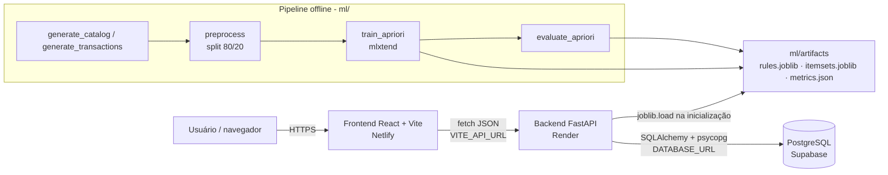

# Arquitetura

## Visão geral

## Camadas

| Camada | Pasta | Responsabilidade |
|---|---|---|
| Frontend | `frontend/` | SPA React + TypeScript. Catálogo, carrinho, checkout, Laboratório IA, autenticação. Three.js na Home. |
| API | `backend/app/api/` | Rotas FastAPI: produtos, recomendações, laboratório, pedidos, usuários. |
| Domínio | `backend/app/services/` | Carga do catálogo, carregamento único (cache) do motor Apriori. |
| Persistência | `backend/app/database/` | Modelos SQLAlchemy e sessão. PostgreSQL em produção, SQLite local/testes. |
| Segurança | `backend/app/core/security.py` | Hash bcrypt, JWT (HS256), dependências de usuário opcional/obrigatório. |
| Mineração | `ml/` | Geração do dataset, pré-processamento, treino e avaliação do Apriori, motor de recomendação. |
| Banco | `database/` | `schema.sql`, migrações e `seed.py`. |

## Fluxo de uma recomendação

1. O usuário altera o carrinho (estado no `CartContext`, persistido no `localStorage`).
2. `useCartRecommendations` aguarda 250 ms (debounce) e chama `POST /api/recommendations` com os IDs.
3. O backend valida os IDs no banco (422 se algum não existir).
4. `RecommendationEngine.recommend()` percorre as regras cujo antecedente está **contido** no carrinho e cujo
   consequente **não** está no carrinho. Para cada candidato fica a regra de maior confiança (desempate por lift).
5. O resultado é ordenado por confiança → lift → ID e limitado a `limit`.
6. A API enriquece cada item com os dados do produto e um texto explicativo (“72% de quem levou…”).
7. Sem regra aplicável, a lista volta vazia com `message`; **não há fallback** por popularidade, para que toda
   recomendação exibida seja de fato uma regra Apriori.

## Papel dos artefatos

O treinamento roda **offline** (local ou CI) e grava listas de dicionários Python puros via `joblib`.
O backend **não** depende de pandas nem de mlxtend em produção: só precisa de `joblib` e de
`ml/recommendation_engine.py`. Isso deixa o deploy no Render leve e evita divergência de versões.

Os artefatos são versionados no Git (arquivos pequenos) para que o deploy seja reproduzível e idêntico ao
avaliado. Retreinar = rodar o pipeline, commitar os novos artefatos e as métricas atualizadas.

## Papel do PostgreSQL

- `products`: catálogo (carregado de `data/catalog/products.csv`). Os preços do pedido saem sempre daqui,
  nunca do cliente.
- `users`: contas (senha com hash bcrypt).
- `orders` / `order_items`: pedidos demonstrativos. `user_id` nulo = visitante. `from_recommendation` registra
  itens adicionados a partir do IPAJ CORE.

O frontend nunca acessa o banco diretamente. As tabelas têm RLS ativado sem políticas, o que bloqueia a API
REST pública do Supabase (roles `anon`/`authenticated`). Só o backend conecta, com a string privada.

Na inicialização, `ensure_schema()` cria as tabelas que faltarem e ativa RLS **na mesma transação**, então a
proteção não depende da ordem dos passos de deploy. O `/health` reporta `database: rls_disabled` se alguma
tabela do app estiver sem RLS. A conexão sempre usa SSL e não usa prepared statements, o que a torna compatível
com os poolers do Supabase. Em produção, o backend recusa iniciar sem PostgreSQL, sem SSL ou com JWT fraco.

## Decisões técnicas

| Decisão | Motivo |
|---|---|
| Regras com consequente único | Recomendação item a item, explicação simples. |
| `max_len = 3` | Cobre combinações “console + acessório → jogo” sem explosão combinatória. |
| Artefatos sem DataFrame | Backend leve; carregamento rápido e sem pandas em produção. |
| Render a partir da raiz do repo | O backend importa `ml/` e lê `ml/artifacts/` e `data/catalog/`. |
| SQLite nos testes | CI sem credenciais nem rede; mesmo ORM do PostgreSQL. |
| JWT em `localStorage` | Simplicidade num projeto acadêmico. Em produção real, preferir cookie `HttpOnly`. |
